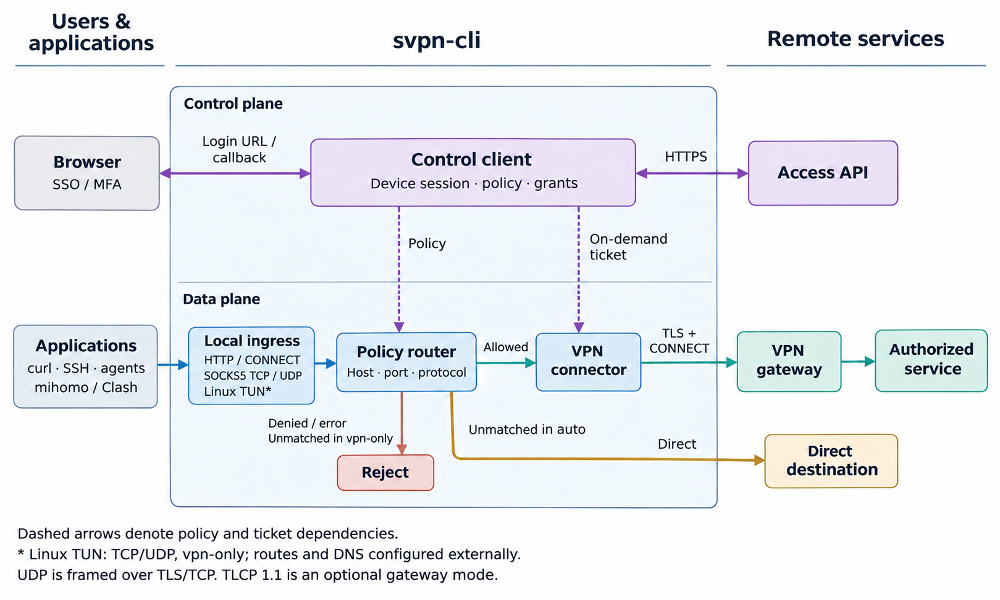

# svpn-cli

[](https://github.com/howtomakeaname/svpn-cli/actions/workflows/ci.yml)
[](https://github.com/howtomakeaname/svpn-cli/releases)
[](LICENSE)

一个轻量的 TCP 远程接入客户端：通过浏览器完成 SSO/MFA，按资源获取访问票据，为 SSH、HTTP 和 HTTPS 应用提供本地 HTTP/SOCKS5 代理。



**当前为实验版本。** Linux 已完成真实登录及 SSH 联调；Windows/macOS 提供原生 CI 测试和发布包，真实部署兼容性仍需使用者验证。项目为第三方互操作工具，与相关厂商或学校无隶属关系。

## 安装

在 [Releases](https://github.com/howtomakeaname/svpn-cli/releases) 下载对应压缩包，用同页的 `SHA256SUMS.txt` 核验后解压。

| 系统 | 平台名 | 架构 |
| --- | --- | --- |
| Linux | linux | amd64 / arm64 |
| macOS | darwin | amd64（Intel）/ arm64（Apple Silicon） |
| Windows | windows | amd64 / arm64 |

Linux/macOS 使用 `svpn-cli`，Windows 使用 `svpn-cli.exe`。二进制尚未代码签名或公证。每个压缩包附带 MIT、依赖许可证和配置示例。

```bash
svpn-cli --version
svpn-cli --help
```

## 登录

只对自己有权限使用的组织和资源操作。组织 PIN、认证域及网关信任信息应由服务部署方提供；学校用户可参考其 [VPN 使用说明](https://inc.sysu.edu.cn/service/vpn)。

```bash
svpn-cli auth init --state private/auth.json --pin YOUR_ORGANIZATION_PIN --machine My-Device
svpn-cli auth sso --state private/auth.json --domain YOUR_AUTH_DOMAIN
```

在自己的浏览器打开输出的 URL，完成正常登录及 MFA。用户浏览器可以位于另一台机器。回到终端运行以下命令，按提示粘贴最终的 **HTTPS SSO 回调**，输入会隐藏：

```bash
svpn-cli auth finish --state private/auth.json
svpn-cli auth exchange --state private/auth.json
svpn-cli auth status --state private/auth.json
```

也可使用 `auth finish --callback-file FILE` 导入私密回调文件。不要把回调 URL 放进命令行参数、Issue 或聊天中。CLI 会检查回调来源、租户、随机 state、十分钟有效期及重复参数；state 单次消费。

凭据文件在 Linux/macOS 使用私密权限，在 Windows 创建受保护的 NTFS DACL，仅授予当前用户及 LocalSystem 访问。读取时验证访问控制；不要将私密状态存到共享目录或版本控制中。

## 两种模式

默认 HTTP 入口为 `127.0.0.1:17890`，SOCKS5 TCP 入口为 `127.0.0.1:17891`。

```bash
# mihomo / Clash 等上游负责选择流量。
svpn-cli serve --state private/auth.json --mode vpn-only

# 应用直接使用本代理，由 CLI 按组织策略分流。
svpn-cli serve --state private/auth.json --mode auto
```

| 请求 | vpn-only | auto |
| --- | --- | --- |
| 命中资源且端口允许 | 经 VPN 网关连接 | 经 VPN 网关连接 |
| 地址受保护但端口不允许 | 拒绝 | 拒绝 |
| 未命中资源 | 拒绝 | 直连 |
| 策略不可用、授权失败或隧道被拒绝 | 拒绝 | 拒绝 |

**VPN 失败不会回退直连。** `auto` 只处理送入代理的请求，不接管整机流量。策略在启动时获取；缓存满五分钟后，在下一次新连接时刷新。ST 按资源缓存，遵守服务器寿命和次数，并合并同目标的并发申请。

```bash
curl --proxy http://127.0.0.1:17890 http://web.internal.example/
curl --proxy socks5h://127.0.0.1:17891 https://web.internal.example/
ssh -o 'ProxyCommand=svpn-cli connect --state /absolute/path/to/private/auth.json %h %p' user@ssh.internal.example
```

Windows 的 `ProxyCommand` 使用可执行文件和状态文件的实际路径。SSH 密码和目标主机密钥校验由 OpenSSH 处理。

mihomo 集成片段见 [examples/mihomo.yaml](examples/mihomo.yaml)。修改示例中的文档地址为自己的授权目标，再并入现有规则。若使用 fake-IP，须由上游还原原始域名；CLI 不共享其 fake-IP 映射。

## TLS 与请求头

默认验证系统 CA、证书主机名和有效期，最低 TLS 1.2。私有部署可显式使用以下之一：

```bash
svpn-cli serve --state private/auth.json --gateway-ca /path/to/trusted-ca.pem
svpn-cli serve --state private/auth.json --certificate-sha256 YOUR_VERIFIED_LEAF_SHA256
```

CA/指纹应通过可信渠道获取。固定叶证书仍检查主机名及有效期，没有自动接受证书或跳过验证的选项。上述信任参数也适用于 `connect`。

默认使用兼容 UA 与网关产品头，不附加实现产品标记。可自定义 User-Agent 或补充控制面/网关头：

```bash
svpn-cli auth init --state private/auth.json --header-profile examples/headers.example.json
svpn-cli serve --state private/auth.json --mode auto --header-profile my-headers.json
svpn-cli serve --state private/auth.json --user-agent 'YOUR_USER_AGENT'
```

`auth init` 将配置保存到私密状态并复用已有 MID；`serve/connect` 的覆盖只作用于本次运行。配置含 `user_agent`、`control_headers`、`gateway_headers`。Host、认证、签名、身份、协议和消息长度字段不能被附加头覆盖；拒绝控制字符、重复名字和过大请求头。进程审计字段仍报告实际进程。

## 边界

- TCP 支持 HTTP、HTTPS 和 SSH；尚无 UDP、TUN、SPA 或国密 TLS。
- 活动连接受所用 ST 到期时间约束；长连接可能届时断开。TGT 自动续期、额外交互挑战和实时撤销未实现。
- 域名规则命中后由网关解析；未命中域名会先经过系统 DNS 再检查 IP。当前没有完整 split-DNS 或多地址容灾。
- 本地代理无用户认证，同机其他用户可能访问。监听器只允许回环 IP，跨机器请用 SSH 转发。
- 控制面和网关不继承环境代理，避免环路和出口不一致。
- `policy`、`ticket`、`check`、`--session` 保留作诊断。日常使用自动取票的 `--state`，不要跨进程重用手工票据。

## 开发与发布

源码需要 Go 1.26+；发布及 CI 使用 Go 1.27.4。

```bash
go test -race ./...
go vet ./...
go build -trimpath -o bin/svpn-cli ./cmd/svpn-cli
python3 scripts/build_release.py --version v0.1.0
```

原生测试在 Linux/macOS/Windows 执行，打包任务构建三系统的 amd64/arm64 共六份产物。推送 `v*` 标签会启动 Release 工作流：测试及构建通过后，校验压缩包，再发布实验版本和 SHA-256 校验文件。保持提交简小，回滚用 `git revert`。

## 许可证

项目原创代码使用 [MIT](LICENSE)。Go 组件的 BSD 许可证见 [THIRD_PARTY_NOTICES](THIRD_PARTY_NOTICES)，第三方名称及归属见 [NOTICE](NOTICE)。发布包不包含官方安装包、组织私密策略或用户凭据。
